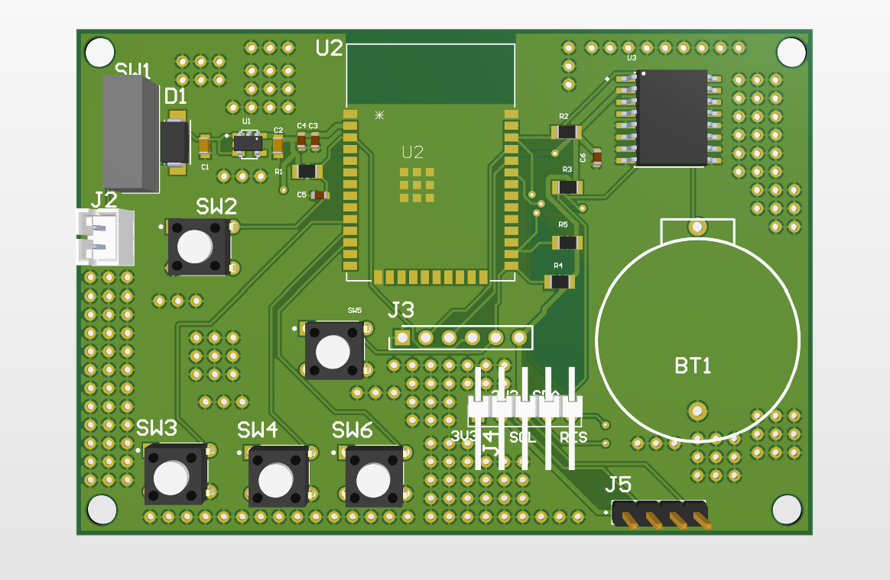
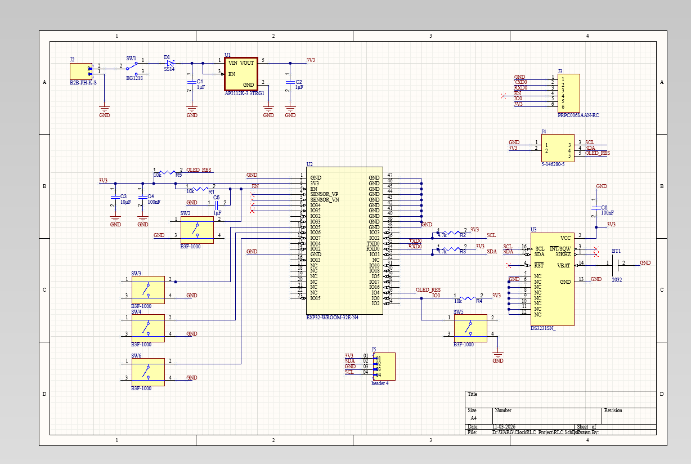
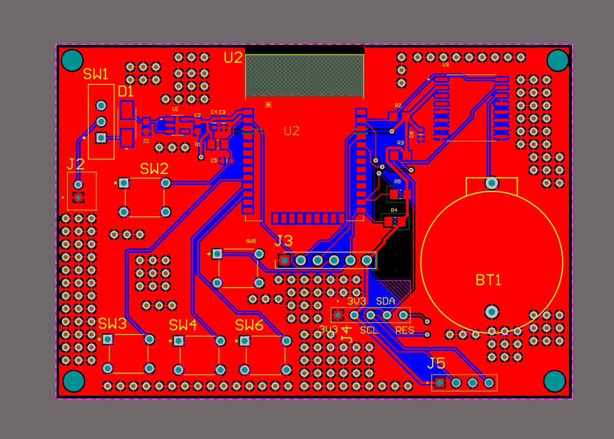
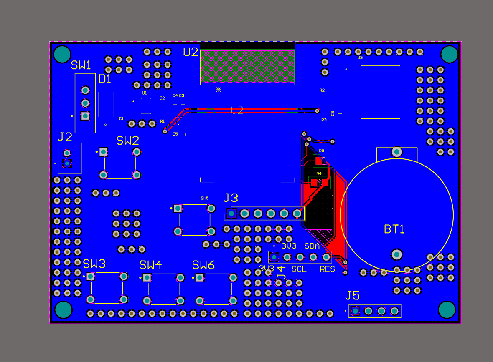

# ESP32 RTC Clock PCB

A battery-powered ESP32 desk clock with a DS3231 real-time clock, a 2.42" I2C OLED, and an AHT20 + BMP280 temperature / humidity / pressure sensor. The board is a 2-layer PCB designed in Altium Designer.

# 3D Render


# Schematic


# pcb layout top layer


# pcb layout second layer


## Status

| Stage | Status |
|---|---|
| Part selection and schematic | Done |
| Custom footprint (CR2032 holder) | Done |
| 2-layer PCB layout | Done |
| Design rule check | Done: 0 shorts, 0 clearance errors, 0 unrouted nets |
| Parts ordered | Done |
| PCB fabrication (JLCPCB) | Not yet |
| Assembly and bring-up | Not yet |
| Firmware | Not written yet |

This is a design repository. The board has not been built or tested yet, and I will update this page as that happens.

## Overview

- **Power:** 3 x AA cells (4.5 V), switched, regulated to 3.3 V
- **Microcontroller:** ESP32-WROOM module
- **Timekeeping:** DS3231SN RTC with CR2032 backup battery
- **Display:** 2.42" 128x64 SSD1309 OLED (I2C), connected by a short cable
- **Sensors:** AHT20 (temperature, humidity) + BMP280 (pressure) on one I2C module
- **Inputs:** SET, UP, DOWN buttons, plus RESET and BOOT buttons
- **Programming:** 6-pin header for an external 3.3 V USB-to-serial adapter (no USB port on the board)

```
3 x AA -> slide switch -> Schottky diode -> 3.3 V LDO -> ESP32 + DS3231 + OLED + sensor
```


## Design decisions

**Power.** The battery feeds a slide switch, an SS14 Schottky diode for reverse-polarity protection, and an AP2112K-3.3 LDO (600 mA). The LDO needs its input about 250 mV above 3.3 V at full load, and the diode drops roughly another 0.3 V, so the usable battery range is slightly reduced. I accepted that trade-off to keep the circuit simple. The LDO has 1 uF ceramic capacitors on its input and output, and the ESP32's 3V3 pin has 10 uF and 100 nF capacitors.

**Reset and boot.** EN has a 10 kOhm pull-up, a 1 uF capacitor to ground (a startup delay), and a reset button. IO0 has a 10 kOhm pull-up and a boot button that pulls it low to enter download mode. This follows Espressif's reference design.

**Programming.** The board is battery powered and has no USB connector. A 6-pin header (GND, TX, RX, EN, IO0, 3V3) connects an external 3.3 V USB-to-serial adapter. Only GND, TX, and RX are connected to the adapter. The board runs from its own batteries while flashing.

**I2C.** One pair of 4.7 kOhm pull-ups on SDA (IO21) and SCL (IO22) serves every device, and the addresses do not collide: DS3231 at 0x68, AHT20 at 0x38, BMP280 at 0x76 or 0x77, and the OLED at 0x3C.

**RTC.** The DS3231 keeps time from a CR2032 while the ESP32 is off or asleep. A 100 nF capacitor sits at its supply pin, and the unused pins follow the datasheet.

**Connectors.** The OLED connects through a 5-pin header and a short Dupont cable (GND, 3V3, SCL, SDA, RES) so the display does not hang off the board by its pins. The sensor is a module on a socket, placed away from the ESP32 and regulator so their heat does not skew readings.

**Custom footprint.** The through-hole CR2032 holder's footprint was drawn from the manufacturer's mechanical drawing (pad spacing, body outline, and keep-out). A mismatch between footprint pad numbers and schematic pin numbers left the battery pads unconnected until I fixed it.

**Manufacturing.** Design rules were set to JLCPCB's 2-layer limits (see below), and the board has a ground pour on both layers.

## Pin map

| ESP32 pin | Function |
|---|---|
| IO21 / IO22 | I2C SDA / SCL |
| IO25 / IO26 / IO27 | SET / UP / DOWN buttons (to GND, use internal pull-ups) |
| IO4 | OLED reset (J4 pin 5, 10 kOhm pull-up; unused with a 4-pin OLED module) |
| IO0 | BOOT button |
| EN | RESET button |
| TXD0 / RXD0 | Programming header (J3) |

## Bill of materials

| Part | Part number / value |
|---|---|
| Microcontroller module | ESP32-WROOM-32E-N4 in the design (32D-N8 purchased, same pinout) |
| RTC | DS3231SN |
| LDO regulator | AP2112K-3.3TRG1 |
| Schottky diode | SS14 (SMA) |
| Slide switch | EG1218 |
| Battery connector | JST-PH B2B-PH-K-S |
| Coin cell holder | CR2032, through-hole (custom footprint) |
| Tactile buttons | B3F-1000 (x5) |
| Capacitors (0603) | 1 uF x3, 100 nF x2, 10 uF x1 |
| Resistors (0603) | 10 kOhm x3, 4.7 kOhm x2 |
| OLED module | 2.42" SSD1309, I2C, 4-pin |
| Sensor module | AHT20 + BMP280 |
| Headers (2.54 mm) | 1x6 male (J3), 1x5 male (J4), 1x4 female (J5) |

## Design rules (JLCPCB 2-layer)

| Rule | Value |
|---|---|
| Clearance | 0.2 mm |
| Signal trace width | 0.2 to 1 mm (preferred 0.25 mm) |
| Power trace width (3V3) | 0.4 to 1 mm (preferred 0.5 mm) |
| Via | 0.8 mm diameter, 0.4 mm hole |
| Minimum annular ring | 0.15 mm |
| Hole-to-hole clearance | 0.5 mm |

The final DRC has no electrical violations. Six cosmetic silkscreen-to-pad warnings remain.

## Bring-up plan

1. Check for shorts between 3V3, VIN, VBAT, and GND before applying power.
2. Solder and test the power section only, and confirm 3.3 V.
3. Add the ESP32 and flash a blink program.
4. Add the DS3231 and run an I2C scanner.
5. Add the OLED and the sensor module.
6. Test the buttons, then measure current draw and estimate battery life.

Results will go here once the board is built.

## Firmware plan

Not written yet. The plan is Arduino/PlatformIO with RTClib, U8g2, and the Adafruit AHTX0 and BMP280 libraries: show the time and sensor readings, set the time with the buttons, and use deep sleep to extend battery life.

